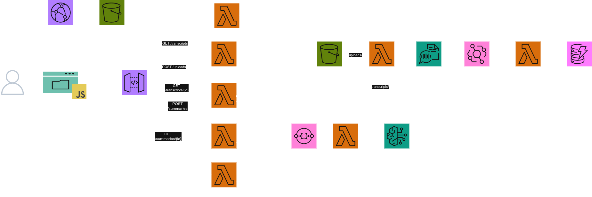

# AWS Audio Intelligence

Aplicación serverless para cargar audios, transcribirlos con Amazon Transcribe y generar un informe consolidado en español con Amazon Bedrock.

## Arquitectura



- Frontend estático en un bucket S3 privado, distribuido por CloudFront con Origin Access Control (OAC).
- API Gateway HTTP API sin autenticación para esta demostración.
- Lambda genera URLs prefirmadas; el navegador carga los audios directamente al bucket privado.
- Los metadatos de archivos y resúmenes se guardan en DynamoDB bajo el espacio compartido `shared`.
- S3 activa la transcripción; EventBridge procesa el resultado de Transcribe.
- Los resúmenes se encolan en SQS y una Lambda los genera con Bedrock.

> Advertencia: al no haber autenticación, todas las personas que accedan a la URL pueden consultar, cargar y generar resúmenes sobre el mismo conjunto de datos. Es adecuado solo para una demo controlada. Para producción, protege la API con un mecanismo de autenticación y autorización apropiado antes de cargar datos sensibles.

## Requisitos

1. Cuenta de AWS y credenciales CLI con permisos para crear los recursos de Terraform, IAM y las políticas asociadas.
2. AWS CLI v2.
3. Terraform 1.6 o posterior.
4. Acceso a un modelo de texto disponible en Amazon Bedrock en la región seleccionada.
5. Amazon Transcribe disponible en esa región.

## Despliegue

Desde `terraform/`:

```bash
cp terraform.tfvars.example terraform.tfvars
terraform init
terraform fmt -recursive
terraform validate
terraform plan -out=tfplan
terraform apply tfplan
```

La configuración inicial usa `us-east-1`, el modelo indicado en `terraform.tfvars.example`, idioma `es-US` y un máximo de 100 MB por audio. Ajusta esos valores en `terraform.tfvars` si tu cuenta o región lo requiere.

Al acabar:

```bash
terraform output
terraform output -raw frontend_url
```

Abre la URL devuelta y sube un audio de prueba. El flujo permite MP3, MP4, WAV, FLAC, OGG, AMR, WEBM y M4A. La URL de descarga de cada resumen dura cinco minutos.

## Flujo de servicios

1. CloudFront sirve el frontend desde el bucket web privado.
2. El navegador llama a API Gateway para crear una carga.
3. `create_upload` guarda el registro en DynamoDB y devuelve una URL prefirmada de S3.
4. La carga en `uploads/` invoca `start_transcribe`; Amazon Transcribe deja el JSON en `transcripts/`.
5. EventBridge invoca `transcribe_complete` y actualiza DynamoDB.
6. Al solicitar un resumen, `create_summary` publica un trabajo en SQS.
7. `summary_worker` lee transcripciones, llama a Bedrock y guarda el Markdown en `summaries/`.

## Diagnóstico

- `AccessDeniedException` de Bedrock: verifica el modelo, la región, los permisos `bedrock:InvokeModel` y posibles SCP.
- Error de carga desde el navegador: revisa CORS de S3 y que el `Content-Type` coincida con el que firmó la URL prefirmada.
- Transcribe falla: revisa CloudWatch Logs de `start_transcribe`, el formato del audio y el idioma.
- Resumen `FAILED`: revisa los logs de `summary_worker` y la disponibilidad del modelo para Converse API.
- `AccessDenied` en Terraform: confirma el rol efectivo con `aws sts get-caller-identity`; una SCP o permission boundary puede prevalecer sobre permisos administrativos.

## Costos y limpieza

AWS puede facturar CloudFront, API Gateway, Lambda, S3, DynamoDB, SQS, Transcribe, Bedrock y CloudWatch. Transcribe y Bedrock suelen ser los costos variables principales.

Para eliminar los recursos, ejecuta `terraform destroy` desde `terraform/`. Los buckets tienen `force_destroy = true`, por lo que se eliminarán audios, transcripciones y resúmenes.
